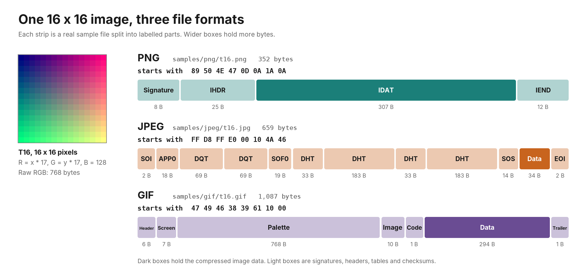

# PNG, JPEG and GIF at byte level



We saved one 16 x 16 test image as a PNG, a JPEG and a GIF. Then we read each file byte by byte, labelled every part and checked that no byte was left out. Project for CSC360 Computer Graphics and Digital Image Processing, Ahmedabad University, Monsoon 2026.

## Results at a glance

| | PNG | JPEG | GIF |
|---|---|---|---|
| Size of the test image | 352 bytes | 659 bytes | 1,087 bytes |
| First bytes | `89 50 4E 47 0D 0A 1A 0A` | `FF D8 FF E0` | `47 49 46 38 39 61` |
| Compression | Row filters, then DEFLATE | DCT, quantization, Huffman | LZW |
| Lossless | Yes | No | LZW yes, 256 colour limit no |
| Byte order | Big-endian | Big-endian | Little-endian |
| Report | [research/02-png.md](research/02-png.md) | [research/03-jpeg.md](research/03-jpeg.md) | [research/04-gif.md](research/04-gif.md) |

Raw RGB for the same image is 768 bytes. The side by side table is in [research/05-comparison.md](research/05-comparison.md).

## Run it

You need Java 17 or newer and nothing else.

```
./build.sh          # Linux and macOS
.\build.ps1         # Windows PowerShell
```

The script compiles everything and runs every demo. Each format demo writes its sample file into `samples/`, prints a table of labelled byte ranges and checks that the ranges cover the whole file. A shortened PNG output:

```
OFFSET   LEN     NAME                   BYTES (first 16)
00000000 8       Signature              89 50 4E 47 0D 0A 1A 0A
00000008 4       IHDR length            00 00 00 0D
0000000C 4       IHDR type              49 48 44 52
00000010 4       IHDR width             00 00 00 10
00000014 4       IHDR height            00 00 00 10
00000021 4       IDAT length            00 00 01 27
00000029 295     IDAT data              78 5E 15 CC 41 81 45 11 00 00 C0 57 E1 57 50 41 ...
0000015C 4       IEND CRC               AE 42 60 82

Coverage: every byte belongs to exactly one segment
```

## What is in the repo

```
research/      write-ups: foundations, PNG, JPEG, GIF, comparison, references
src/imgformats/  Java code, one package, JDK only
samples/       the generated PNG, JPEG and GIF
docs/          the figure at the top of this page
slides/        the presentation as a PDF
build.sh       compile and run (Linux, macOS)
build.ps1      compile and run (Windows)
```

## The code

| Class | What it does |
|-------|--------------|
| `PngInspector`, `JpegInspector`, `GifInspector` | Split a real file into labelled byte ranges |
| `PngDemo`, `GifDemo` | Write the sample, print the table, check the coverage |
| `PngFilterDemo` | Shows the five PNG row filters on real rows |
| `JpegDctDemo` | Runs our own DCT and quantization on one 8x8 block |
| `GifLzwDemo` | Encodes and decodes a short index sequence with LZW |
| `FoundationsDemo` | Raw sizes and byte order |
| `ComparisonDemo` | Lists the samples and names each format from its first bytes |
| `OverviewFigure` | Draws `docs/overview.png` from the sample files |

`JpegInspector` also writes the JPEG sample. `Segment`, `FormatInspector`, `HexDump` and `TestImage` are the shared helpers. To redraw the figure after a build, run `java -cp out imgformats.OverviewFigure` from the repo root.

## Wiki

The wiki has a page for each format, a guide to the code, a glossary and a FAQ: https://github.com/Jawal23/CSC360-Group7/wiki

## Authors

| Name | Part |
|------|------|
| Yug Bangoriya | PNG |
| Devraj Sangharajka | JPEG |
| Dvij Desai | GIF |
| Jawal Agrawal | Foundations, comparison, build scripts, slides |

Sources are listed in [research/references.md](research/references.md).
